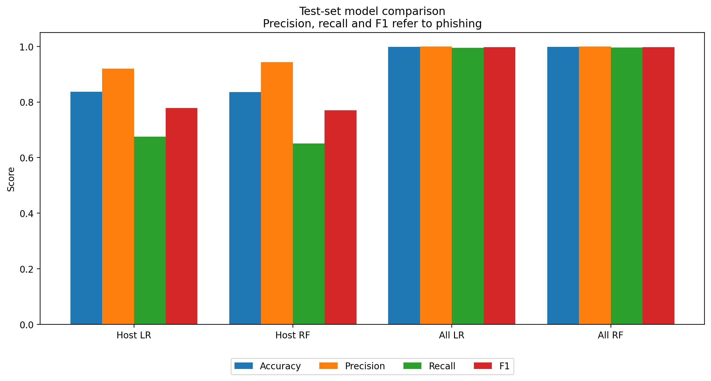
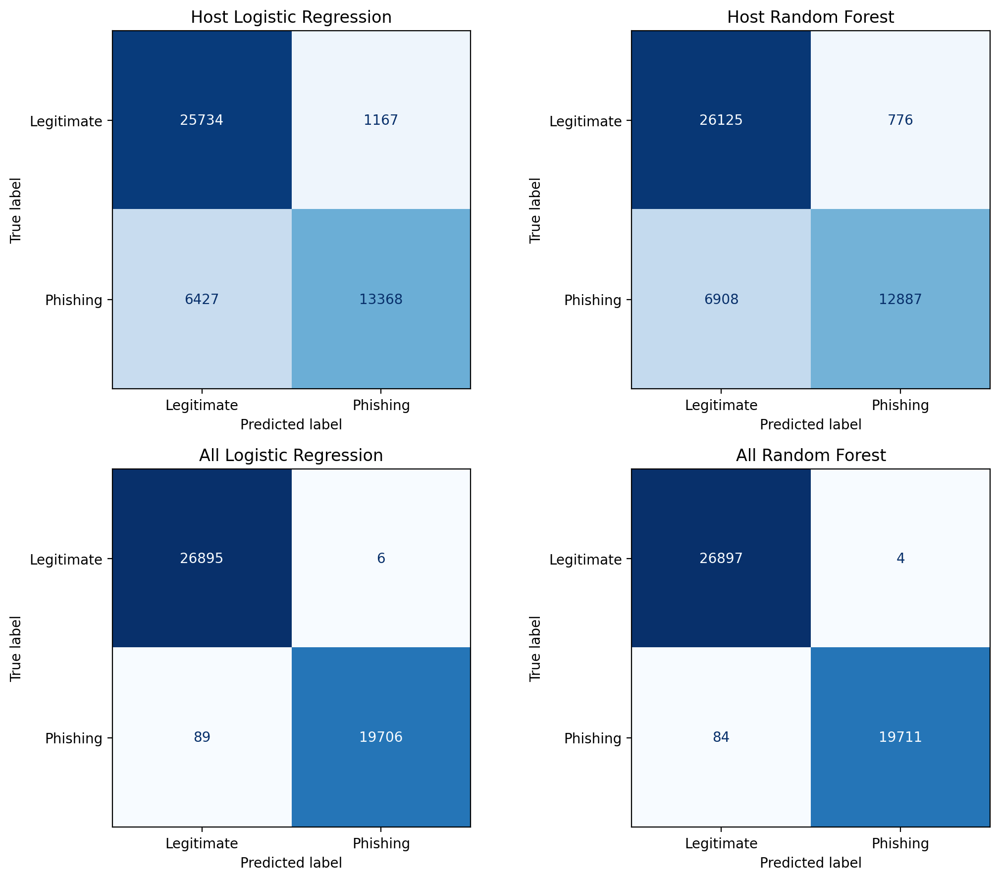

# Member 4 — Evaluation and Error Analysis

**Contributor: Diya Rathod**

This folder evaluates Member 3's four saved models on Member 1's shared test set, using Member 2's URL feature extraction. It contains evaluation code, comparison figures, saved predictions and written analysis of 16 error examples. The Word report is being reviewed separately.

## Run the evaluation

Use the complete repository so the shared data, feature extraction module, public suffix list and saved models are available. Python 3.12 or 3.13 is recommended for this project. From the repository root:

```bash
python -m pip install -r Member4_Evaluation/requirements.txt
python Member4_Evaluation/evaluate.py
```

The script resolves paths relative to its own location. It also works when run from another working directory using its full path. It does not visit any URLs or train models. Running it again replaces the generated CSVs and figures in this folder.

### Google Colab

With the repository already cloned to `/content/Phishing_Detection`, install the requirements in a cell:

```python
%pip install -r /content/Phishing_Detection/Member4_Evaluation/requirements.txt
```

Restart the runtime if scikit-learn or pandas was already imported, then run:

```python
!python /content/Phishing_Detection/Member4_Evaluation/evaluate.py
```

The saved model metadata specifies scikit-learn **1.9.1** and pandas **3.1.1**. The script checks these versions before loading the models. Installing the listed Bottleneck dependency also resolves the older Bottleneck warning encountered in Colab. No retraining is needed to evaluate these saved models.

## Evaluation procedure

1. Check required columns, missing values, labels, and duplicate URLs or source records. Confirm that training and test sets share no URLs, domain groups or source records.
2. Recreate the five training CV folds with `StratifiedGroupKFold(n_splits=5, shuffle=True, random_state=42)`, grouped by `domain_group`. Check that domains do not cross between fitting and validation data and that every training row appears in validation once.
3. Load each saved pipeline and predict from the raw test URLs. Calculate accuracy, phishing precision, recall, F1 and a confusion matrix.
4. Compare the test F1 scores with Member 3's saved CV results. **Member 3 performed the CV model training and tuning. Member 4 verifies the splits and reuses those scores; this script does not rerun model training.**
5. Export every error, sample two false positives and two false negatives per model with seed 42, and attach Member 2's feature values to the examples.
6. Examine phishing recall among URLs with the structure shared by all legitimate test URLs: HTTPS, a hostname starting with `www.`, and an empty path, query and fragment. A trailing slash does not match this definition.

**Label convention:** `0 = Phishing`, `1 = Legitimate`. Precision, recall and F1 use `pos_label=0`. The confusion matrices use `labels=[1, 0]`, so their rows and columns are ordered Legitimate then Phishing, and the flattened counts are TN, FP, FN, TP.

The final test set is excluded from fitting, CV and tuning. The script uses the models' saved `predict()` decisions and leaves Member 3's selected model unchanged. The structure check is exploratory analysis of test errors, not a separate independent validation set.

## Results

Training contains **188,674** rows; testing contains **46,696** rows, including **19,795 phishing** and **26,901 legitimate** URLs. There is no overlap in URLs, domain groups or record IDs between the splits.

| Model | Accuracy | Phishing precision | Phishing recall | Phishing F1 |
|---|---:|---:|---:|---:|
| Host Logistic Regression | 0.8374 | 0.9197 | 0.6753 | 0.7788 |
| Host Random Forest | 0.8354 | 0.9432 | 0.6510 | 0.7703 |
| All Logistic Regression | 0.9980 | 0.9997 | 0.9955 | 0.9976 |
| All Random Forest | 0.9981 | 0.9998 | 0.9958 | 0.9978 |





The all-feature scores need to be read alongside the structure analysis. All 26,901 legitimate test URLs have the matching structure, compared with only 118 phishing URLs. Within those 118 phishing URLs, Host LR and Host RF each detect 56, All LR detects 29 and All RF detects 34. The 89 All LR misses and 84 All RF misses in that subgroup account for all their test-set false negatives. This is consistent with reliance on a collection pattern; it does not prove the effect of any individual feature.

Member 3 selected **Host Logistic Regression** using training CV among the host models. That selection is preserved. Its 6,427 missed phishing URLs also show that removing the structure features does not solve the detection problem.

## Files

| File or folder | Purpose |
|---|---|
| `evaluate.py` | Reproduce the evaluation with the four saved pipelines |
| `requirements.txt` | Evaluation dependencies, including model-compatible versions |
| `figures/confusion_matrices.png` | Confusion matrices for all four models |
| `figures/model_comparison.png` | Accuracy, precision, recall and F1 comparison |
| `results/class_counts.csv` | Training and test class counts |
| `results/split_checks.csv` | Training/test overlap checks |
| `results/test_metrics.csv` | Full-precision test metrics |
| `results/error_counts.csv` | TN, FP, FN and TP for each model |
| `results/test_predictions.csv` | All test records with four model predictions |
| `results/cv_fold_checks.csv` | Row counts and domain overlap for the five training folds |
| `results/member3_cv_results.csv` | Member 3's CV results with a combined model name |
| `results/cv_test_comparison.csv` | Test F1, CV mean F1 and CV F1 standard deviation |
| `results/misclassified_urls.csv` | Every model-record error, including error type |
| `results/error_examples.csv` | Two examples per model and error type, with extracted features |
| `results/analysed_error_examples.csv` | Written interpretation of all 16 sampled examples |
| `results/url_structure_summary.csv` | URL structure counts by class |
| `results/matching_structure_recall.csv` | Detection counts and recall for matching phishing URLs |
| `results/evaluation_info.json` | Runtime versions, CV attribution and evaluation settings |

The written annotations are reviewed separately and are not overwritten by the script. They describe the current saved models and dataset. If either changes, review the annotations and the results quoted in this README. Explanations in the annotations are hypotheses based on visible features and model disagreements; local feature contributions were not calculated. Website labels come from the dataset and are not current safety assessments.

## Validation

The standalone script was run with Python 3.12.14, scikit-learn 1.9.1 and pandas 3.1.1 against all four saved models. Every test prediction matched the original Colab output. The metrics, error counts, CV tables, all 15,461 model-record errors and 16 sampled examples also matched. The domain-overlap guard was checked with different URLs sharing a domain, the structure check was tested for paths, queries, fragments and trailing slashes, and both generated figures were visually checked. Run-specific package versions are recorded in `results/evaluation_info.json`.

## Limitations and improvements

- Domain separation prevents domain overlap but cannot remove a collection pattern shared by different domains. Add more varied legitimate URLs and phishing URLs with ordinary root-domain structures, then test on independent, newer data.
- URL text cannot capture every sign of phishing. Page or redirect information could be investigated in future work; this evaluation performs no network lookups.
- Fixed brand, keyword and suffix lists have limited coverage and can also flag legitimate domains. Validate changes against both error types using training data.
- The 16 examples are illustrative, and the 118-URL subgroup was examined after reviewing test errors. Use a fresh, predefined subgroup evaluation to test improvements.
- Member 3's CV scores come from hyperparameter selection, so they are tuning scores rather than an independent nested CV estimate. Keep all future tuning within training data and reserve a fresh holdout for final assessment.

## Sources and contribution

- [PhiUSIIL dataset, Prasad and Chandra, UCI Machine Learning Repository](https://archive.ics.uci.edu/dataset/967/phiusiil+phishing+url+dataset).
- Shared preprocessing and splits: `Member1_Phishing_Detection`.
- URL feature extraction and the original training structure audit: `Member2_Phishing_Detection`.
- Saved pipelines, model metadata and training CV results: `Member3_Model_Development`.
- [StratifiedGroupKFold documentation](https://scikit-learn.org/stable/modules/generated/sklearn.model_selection.StratifiedGroupKFold.html).

ChatGPT assisted with organising the evaluation code, checking results and drafting error interpretations. Diya ran the original evaluation in Colab. The model training and CV scores are Member 3's work. The report will be reviewed separately before submission.
